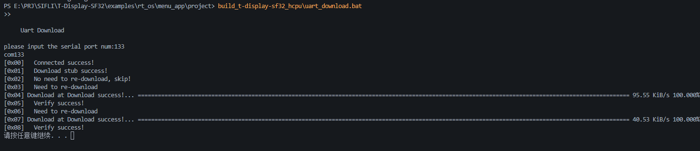

<div align="center" markdown="1">
  
</div>

<h1 align = "center"> T-SF32-Dispaly </h1>


# SDK
点击网址跳转到SDK，下载并存放在你想要的路径上[https://github.com/Xinyuan-LilyGO/SlFli-SDK-Lilygo](https://github.com/Xinyuan-LilyGO/SlFli-SDK-Lilygo)
如果要更新SDK版本，请查看update_sdk_install.md文档，[https://github.com/Xinyuan-LilyGO/SlFli-SDK-Lilygo/blob/master/update_sdk_install.md](https://github.com/Xinyuan-LilyGO/SlFli-SDK-Lilygo/blob/master/update_sdk_install.md)

# 概述
T-SF32-Dispaly开发板是基于思澈科技(SiFli)最新推出的超低功耗AIoT MCU芯片SF32LB52X的开发平台。该开发板专为智能穿戴、智能家居、工业传感和物联网应用设计，集成了丰富的外设接口和传感器。

## T-SF32-Display 功能支持表

下表说明 T-SF32-Display 主板自身支持的功能。由可选 T-SF32-Keyboard 扩展板提供的功能会单独标明。

| 功能                                         | 支持状态 | 使用要求和限制                                                                |
| -------------------------------------------- | -------- | ----------------------------------------------------------------------------- |
| SF32LB52X HCPU 和 LCPU                       | ✅        | SiFli SDK 支持 HCPU 和 LCPU 应用。                                            |
| 经典蓝牙和 BLE 5.3                           | ✅        | 需要添加对应的 LCPU 蓝牙镜像，并在 HCPU 端实现蓝牙应用。                      |
| AMOLED 显示                                  | ✅        | 板载 2.16 英寸 CO5300 AMOLED 屏幕。                                           |
| 电容触摸                                     | ✅        | 板载 CST9220 触摸控制器。                                                     |
| 音频输入和输出                               | ✅        | 支持板载麦克风、扬声器功放和 3.5 mm 音频接口。                                |
| LoRa                                         | ✅        | 板载兼容 SX1262 的 LoRa 模块                                                  |
| TF / microSD 卡                              | ✅        | 使用共享的 SPI1 总线和独立片选信号。                                          |
| IMU                                          | ✅        | 板载 BHI260AP 传感器，通过 I2C1 连接。                                        |
| 电池充电和状态检测                           | ✅        | 使用板载 SGM41562B，应用固件必须实现低电量保护。                              |
| 三个用户按键                                 | ✅        | 分别连接 PA33、PA34 和 PA35。                                                 |
| USB 转串口下载和日志                         | ✅        | 板载 Type-C 数据线连接到 CH343P USB 转串口芯片。                              |
| TF/microSD的SDIO/SDMMC 接口                            | ❌        | TF 卡按 SPI 模式连接                                                          |
| 通过板载 Type-C 使用原生 USB MSC、CDC 或 HID | ❌        | SF32LB52X 支持 USB Device，但板载 Type-C 的 D+/D- 没有连接 MCU。              |
| 通过板载 Type-C 使用 USB Host                | ❌        | 板载接口连接到 CH343P，没有 MCU USB Host 数据通路和 Host VBUS 控制电路。      |
| Wi-Fi                                        | ✅        | 需要 T-SF32-Keyboard 板上的 ESP32-C6 及其 AT 固件，并与 L76K GPS 复用 UART2。 |
| GPS                                          | ✅        | 需要 T-SF32-Keyboard 板上的 L76K，并与 ESP32-C6 复用 UART2。                  |
| 矩阵键盘和键盘 LED                           | ✅        | 需要带 TCA8418、AW21009 和 XL9555 的 T-SF32-Keyboard 板。                     |
| 温度、湿度和气压检测                         | ✅        | 需要 T-SF32-Keyboard 板上的 BME280。                                          |
| 红外发射                                     | ✅        | 需要 T-SF32-Keyboard 板上的红外发射器，并占用 PA36。                          |
| 振动马达                                     | ✅        | 需要 T-SF32-Keyboard 板上的 AW86224 和马达。                                  |

# 注意事项
- SF32LB52X芯片的启动电压要大于3.5V，所以请确保电池电压在3.5V以上，否则无法正常启动。
- 烧录自己写的固件时，请提前做好电池电压检测和低电量关机功能，否则容易导致电池过放。
- 烧录过程中失败，请先检查是否正确连接了电池，然后重新烧录。
- 如果终端烧录启动等待很久，请重新插拔USB线。

# 硬件特性
## 1、MCU
|            | SF32LB52X                                |
| ---------- | ---------------------------------------- |
| 型号       | SF32LB52X                                |
| 处理器     | Arm Cortex-M33 STAR-MC1大小核架构        |
| 大核(HCPU) | 192MHz，787 CoreMark                     |
| 小核(LCPU) | 24MHz                                    |
| 内存       | 576KB SRAM (512KB+64KB)                  |
| 蓝牙       | 双模蓝牙5.3 (BLE 5.3, Classic Bluetooth) |
| 图形引擎   | ePicassoTM 2.5D高性能图形引擎            |
| 工作电压   | 3.2V-4.7V                                |

## 2、外设模块
| 模块           | 型号              | 描述                                                                   |
| -------------- | ----------------- | ---------------------------------------------------------------------- |
| 蓝牙           | -                 | 双模蓝牙5.3，支持BLE Audio，接收灵敏度-100dBm(1Mbps)                   |
| 音频           | -                 | 24-bit音频ADC/DAC，支持蓝牙音频传输                                    |
| LoRa           | SX1262            | 433/868/915MHz，低功耗，高接收灵敏度                                   |
| TF卡           | MicroSD           | 支持SDHC/SDXC                                                          |
| IMU            | BHI260AP          | 三轴加速度计、陀螺仪、磁力计，低功耗模式                               |
| 充电管理       | SGM41562B         | USB PD快充，电池管理，支持多种充电协议                                 |
| 键盘           | TAC8418 + AW21009 | 8x8矩阵键盘，低功耗设计(仅T-SF32-keyborad board)                       |
| 拓展IO         | XL9555            | 16IO拓展      (仅T-SF32-keyborad board)                                |
| GPS            | L76K              | 支持NMEA,CASIC协议，高精度定位  (仅T-SF32-keyborad board)              |
| WIFI&BLUE 模块 | ESP32C6           | 串口连接,使用ESP32C6 AT固件，与L76K复用UART2 (仅T-SF32-keyborad board) |
| 温湿度传感器   | BME280            | (仅T-SF32-keyborad board)                                              |
| 红外发射       | VSMY14940         | (仅T-SF32-keyborad board)                                              |
| 震动马达       | AW86224           | (仅T-SF32-keyborad board)                                              |

## 3、存储
| 模块  | 型号 |
| ----- | ---- |
| Flash | 16MB |
| PSRAM | 8MB  |

## 4、显示
| 模块          | 型号     |
| ------------- | -------- |
| AMOLED(2.16") | (CO5300) |
| 触摸屏        | CST9220  |

## 5、接口
| 接口     | 类型   | 描述 |
| -------- | ------ | ---- |
| USB      | Type-C |      |
| 串口     | UART   |      |
| I2C      | 4通道  |      |
| SPI      | 2通道  |      |
| GPIO     | 45个   |      |
| 音频     | 3.5mm  |      |
| JTAG/SWD | -      |      |

# T-SF32 引脚
| 引脚 | 功能         | 描述                                                                           |
| ---- | ------------ | ------------------------------------------------------------------------------ |
| PA0  | TP_RST       |                                                                                |
| PA1  | TP_INT       |                                                                                |
| PA2  | LCD_TE       |                                                                                |
| PA3  | LCD_CS       |                                                                                |
| PA4  | LCD_CLK      |                                                                                |
| PA5  | LCD_D0       |                                                                                |
| PA6  | LCD_D1       |                                                                                |
| PA7  | LCD_D2       |                                                                                |
| PA8  | LCD_D3       |                                                                                |
| PA9  | LCD_RST      |                                                                                |
| PA10 | L76K_PPS     |                                                                                |
| PA11 | TCA8418_IRA  | 键盘按键中断                                                                   |
| PA12 | FLASH_CS     |                                                                                |
| PA13 | FLASH_MOSI   |                                                                                |
| PA14 | FLASH_WP     |                                                                                |
| PA15 | FLASH_MISO   |                                                                                |
| PA16 | FLASH_SCK    |                                                                                |
| PA17 | FLASH_HOLD   |                                                                                |
| PA18 | UART_RXD     |                                                                                |
| PA19 | UART_TXD     |                                                                                |
| PA20 | NS4150B_CTRL | 音频功放开关                                                                   |
| PA22 | 32K_XI       | 晶振输入                                                                       |
| PA23 | 32K_XO       | 晶振输出                                                                       |
| PA24 | SPI1_MOSI    |                                                                                |
| PA25 | SPI1_MISO    |                                                                                |
| PA26 | LORA_EN      |                                                                                |
| PA27 | BHI260AP_IRQ |                                                                                |
| PA28 | SPI1_SCK     |                                                                                |
| PA29 | LORA_CS      | SPI1                                                                           |
| PA30 | LORA_IRQ     |                                                                                |
| PA31 | LORA_BUSY    |                                                                                |
| PA32 | LROA_RST     |                                                                                |
| PA33 | BUTTON       | 主机'C'按键                                                                    |
| PA34 | BUTTON       | 主机'A'按键                                                                    |
| PA35 | BUTTON       | 主机'B'按键                                                                    |
| PA36 | IR_PWM       | 红外                                                                           |
| PA37 | I2C1_SDA     | CST9220 & BHI260AP & SGM41562B & TAC8418 & AW21009 & BME280 & AW86224 & XL9555 |
| PA38 | I2C1_SCL     | CST9220 & BHI260AP & SGM41562B & TAC8418 & AW21009 & BME280 & AW86224 & XL9555 |
| PA39 | UART2_RXD    | GSP & ESP32C6                                                                  |
| PA40 | UART2_TXD    | GSP & ESP32C6                                                                  |
| PA41 | LDO_3V3_EN   |                                                                                |
| PA42 |              | 保留                                                                           |
| PA43 | SD_CS        | SPI1                                                                           |
| PA44 | VCI_EN       | LCD                                                                            |

- 主机'D'按键是SGM41562B的中断引脚，用于从船运（ship mode）模式启动。

# T-SF32-Dispaly功耗
请查看[功耗测试报告](./lowpowertest/T-SF32-Display-power.pdf)，在“./lowpowertest/T-SF32-Display-power.pdf”目录。

# 环境安装
## Windows
请参考[T-SF32-Display SFILI-SDK  Windows Installation](https://github.com/Xinyuan-LilyGO/SlFli-SDK-Lilygo/blob/master/readme.md)

## Linux and macOS
请参考[SFILI-SDK macOS and Linux Installation](https://docs.sifli.com/projects/sdk/v2.4/sf32lb52x/quickstart/install/script/unix.html)

# 编译和烧录
1. 先按照安装环境的要求安装好依赖包，并配置好环境变量(以下命令在powershell中执行)
```powershell
    cd SIFLI\T-Display-SF32\examples\rt_os\rt_driver\project //进入工程目录
    scons --board=t-display-sf32_hcpu -j8   //编译
    build_t-display-sf32_hcpu\uart_download.bat     //烧录
```
2. 等待编译完成，执行build_t-display-sf32_hcpu\uart_download.bat命令，在输入设备端口号，即可烧录。
3. 示例图片




# 🎯官网文档
本例程参考官方网站给出示例，具体文档请参考以下链接：
[SFILI-SDK](https://docs.sifli.com/projects/sdk/v2.4/sf32lb52x/index.html)
[SFILI-WIKI](https://wiki.sifli.com/)
[RT-Thread](https://www.rt-thread.org/document/site/#/rt-thread-version/rt-thread-standard/README)

# FAQ

#### 1. 为什么在menuconfig中已经配置了蓝牙相关宏，但是无法正常使用蓝牙功能？
可能原因：
1.在SConript和SConstruct中，没有添加LCPU的编译选项相关文件, lcpu_general_ble_img 里面是LCPU默认的代码，里面包含了BLE的启动，对于用户只使用BLE的基本功能，可以将lcpu_img.c加入用户HCPU工程，参考BLE里面的示例使用。。
```c
SConript:
    objs.extend(SConscript(os.path.join(SIFLI_SDK, 'example/rom_bin/lcpu_general_ble_img/SConscript'), variant_dir="lcpu_patch", duplicate=0))

SConstruct:
    AddLCPU(SIFLI_SDK,rtconfig.CHIP,"../../src/lcpu_img.c")
```

#### 2. Impeller一直烧录失败，是什么原因？
可能原因：
1. Impeller烧录需要使用USB Type-C接口，请确保使用正确的接口。
2. 确保设备端口号正确，可以使用设备管理器查看设备端口号。
3. 确保设备已经正确连接，可以使用设备管理器查看设备是否已经连接。
4. 确保设备已经正确安装驱动，驱动文件路径`tools/VisualCppRedist_54_Setup.7z`,[c++Driver](./tools/VisualCppRedist_54_Setup.7z)。

#### 3.为什么出厂固件(menu_app)关机之后,USB充电无法开机？
因为出厂固件(menu_app)在关机之后,会进入低功耗模式,低功耗模式下，只有按键才能唤醒设备，而USB充电无法唤醒设备，但是可以给设备充电，所以可以正常充电，但是无法开机。


